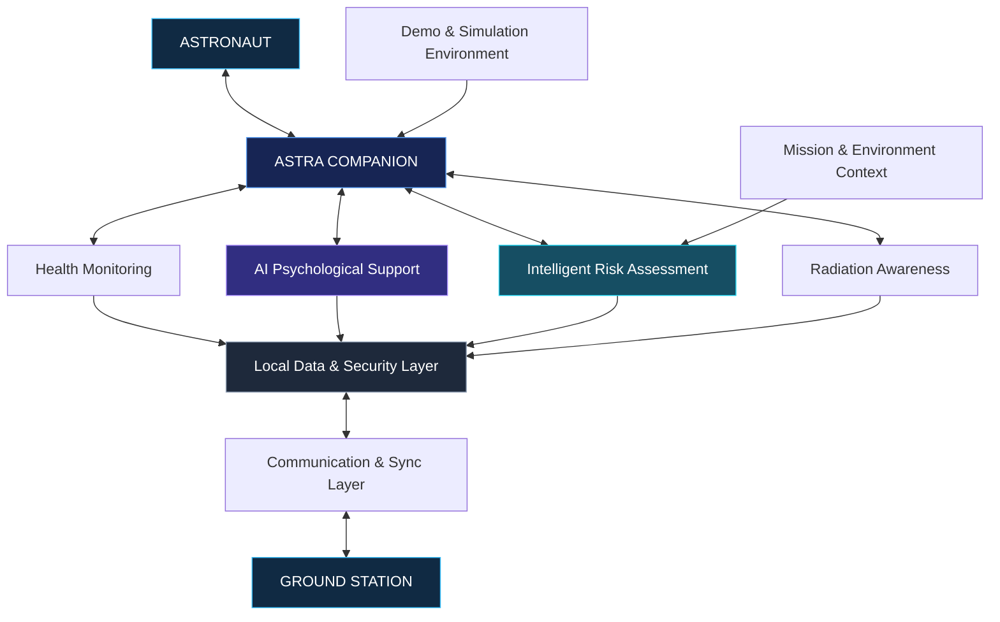

# 🚀 ASTRA Companion
### Beyond Monitoring. Supporting Human Life in Space.

  <strong>An Intelligent Astronaut Health & Well-being System</strong>
   
  Designed for the challenges of long-duration Moon and Mars missions.

---

## 🌌 The Challenge

Human space exploration introduces challenges that extend far beyond physical health.

During long-duration missions, astronauts face isolation, communication delays, radiation exposure, disrupted sleep, psychological stress, and limited access to immediate medical support.

Traditional monitoring approaches cannot fully address the need for continuous health awareness, personalized support, and reliable operation when communication with Earth is unavailable.

**Astronauts need more than monitoring. They need a system that understands their condition, supports their well-being, and remains dependable beyond Earth.**

## ✨ Our Solution

**ASTRA Companion** is an intelligent, offline-first astronaut health and well-being system designed for long-duration Moon and Mars missions.

It brings together physical health monitoring, AI-powered psychological support, intelligent risk assessment, and secure autonomous data management within one integrated system.

ASTRA focuses on three essential goals:

- **Monitor:** Track physical and psychological well-being over time.
- **Understand:** Identify unusual trends and potential risks using personalized baselines and contextual information.
- **Support:** Provide astronauts with timely guidance and supportive interventions, while keeping Earth-side medical teams informed.

## 🧬 Core System Capabilities

### 01 — Physical Health Intelligence
Continuous awareness of the astronaut's physical condition.

- Monitor vital signs and health indicators.
- Track heart rate, SpO₂, blood pressure, glucose, temperature, and sleep.
- Record symptoms such as dizziness and fatigue.
- Compare measurements against personal health baselines.
- Identify unusual trends and potential health concerns.
- Support follow-up monitoring after radiation exposure.

### 02 — AI Psychological Companion
More than a monitoring system — a companion beyond Earth.

Long-duration space missions can affect emotional well-being, motivation, sleep, and cognitive performance.

ASTRA's AI Companion provides an interactive layer of psychological support through:

- Emotional check-ins and mood tracking.
- Stress and energy self-assessment.
- Conversational AI interaction.
- Personalized breathing and relaxation activities.
- Supportive recommendations based on reported well-being.
- Voice interaction for a more natural astronaut experience.

The goal is to make psychological support accessible, personal, and available even when Earth is far away.

### 03 — Intelligent Risk Assessment
Turn health observations into meaningful decision support.

- Evaluate measurements against personal baselines.
- Detect unusual patterns and changes over time.
- Combine relevant health and mission context.
- Prioritize alerts according to their urgency.
- Provide understandable explanations for detected concerns.

ASTRA supports human decision-making; it does not replace medical professionals or provide diagnoses.

### 04 — Radiation Awareness & Follow-up
Radiation exposure is a major consideration in missions beyond Earth's protective environment.

ASTRA supports radiation-related awareness through:

- Dosimeter-based exposure monitoring.
- Cumulative exposure tracking.
- Radiation event alerts.
- Post-exposure symptom and health timelines.
- Follow-up monitoring windows.
- Clear instructions and status updates during simulated emergency scenarios.

### 05 — Ground Station
Keeping mission-support teams informed from Earth.

The Ground Station provides an Earth-side interface for medical and mission-support personnel.

- Crew health overview and status summaries.
- Individual astronaut profiles.
- Current and historical health trends.
- Mission history and longitudinal monitoring.
- Health and radiation alerts.
- Authorized mission commands and monitoring settings.
- Communication and backup status.

When communication is interrupted, the Ground Station clearly identifies last-received information and its age.

### 06 — Secure Offline Operation
Space communication is not always immediate or continuously available.

ASTRA is designed with offline-first principles:

- Local operation without runtime internet dependency.
- Autonomous functionality during communication interruptions.
- Secure handling of sensitive information.
- Data integrity verification.
- Local data backup and controlled synchronization.
- Communication state and delayed data awareness.
- Backend-managed signing operations and keys.

---

## 🛰️ System Architecture

ASTRA is designed as an integrated ecosystem connecting the astronaut, AI Companion, health intelligence services, and Earth-side mission support.

The architecture is built around local availability, modular services, secure data handling, and resilient communication.

## 💡 What Makes ASTRA Different?

| Traditional Monitoring | ASTRA Companion |
|---|---|
| Focuses mainly on physical readings | Integrates physical and psychological well-being |
| Uses fixed reference thresholds | Incorporates personal health baselines |
| Primarily reports current conditions | Tracks trends and potential risks |
| Depends heavily on communication | Designed for offline-first operation |
| Separates health and emotional support | Brings both into one integrated system |
| Provides limited mission context | Considers health, radiation, and mission conditions |

**Our key idea:** Protecting astronaut health means understanding the whole human being — not just monitoring numbers.

## 🔭 Designed for Deep-Space Missions

ASTRA is designed around the operational challenges of missions to the Moon and Mars.

- **Isolation:** Accessible psychological support through the AI Companion.
- **Communication delays:** Local capabilities that do not depend on continuous Earth connectivity.
- **Radiation exposure:** Dosimeter-based monitoring and post-exposure follow-up.
- **Limited medical access:** Health trends and explainable alerts to support medical decision-making.
- **Long mission duration:** Personal baselines and longitudinal health history.
- **Data security:** Local protection and integrity verification.

## 🧪 Current Prototype & Evaluation

The current implementation demonstrates ASTRA's core concepts through simulated astronauts, health readings, and mission scenarios.

The prototype includes:
- Astronaut-facing health and well-being interface.
- Earth-side Ground Station.
- AI Psychological Companion.
- Health and risk assessment engine.
- Radiation event simulation.
- Communication and Link Simulator.
- Security and attack simulation.
- Mission scenario evaluation and automated tests.

The system is intended to evolve into a more complete integrated solution with validated medical references, approved operational protocols, and appropriate hardware integrations.

## ⚠️ Safety & Scientific Boundaries

ASTRA is a decision-support prototype, not a diagnostic or treatment system.

- All current crew profiles, readings, and scenarios are simulated.
- Health thresholds and plausibility limits are demonstration-only until reviewed against approved NASA and medical references.
- Radiation exposure is measured by dosimeters. Health trends are used for follow-up and are not treated as proof of radiation causation.
- Shelter instructions remain placeholders pending approved source text.
- The Ground Station distinguishes last-received information from live information.
- Raw audio is not stored or uplinked, and signing keys remain in backend processes.

## 🌠 Our Vision

The future of space exploration depends not only on how far humanity can travel, but also on how well we protect the people making those journeys possible.

ASTRA aims to make astronaut health support more intelligent, personal, secure, and resilient — bringing physical monitoring and psychological well-being together in a system designed for life beyond Earth.

  <strong>ASTRA Companion</strong>
   
  <em>Because every mission begins with a human life.</em>
    
  Built for the future of human space exploration. 🚀

